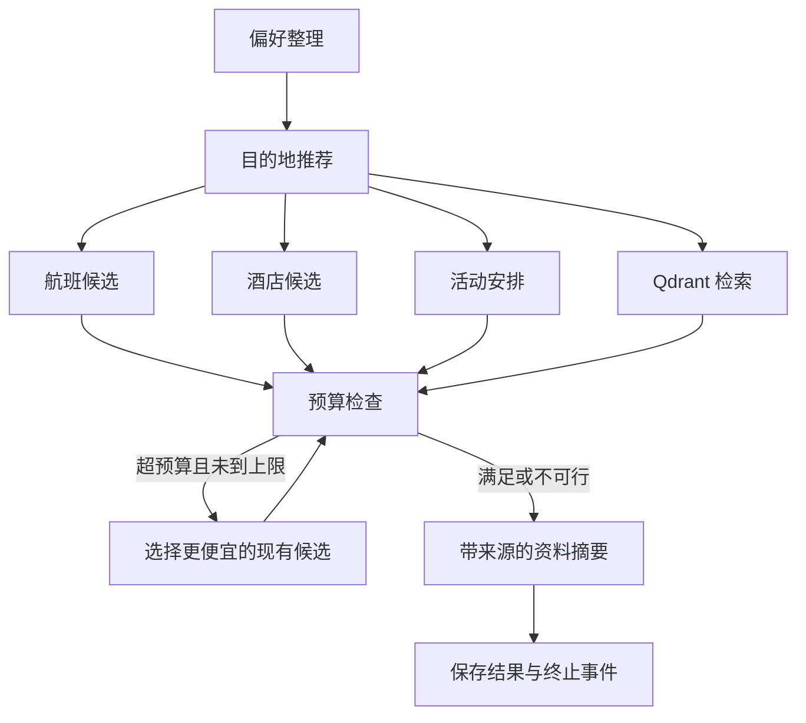

# 多 Agent 旅游规划 · Python 二次开发版

基于 [bcefghj/multi-agent-travel-planner](https://github.com/bcefghj/multi-agent-travel-planner) 的 Python 版本扩展。保留来源说明，将上游源码快照与新增功能分别提交；新增 LangGraph、Qdrant RAG、Redis 任务与缓存、可重连 SSE 和浏览器演示页。来源与修改范围见 [UPSTREAM.md](UPSTREAM.md)。

## 快速启动

要求 Python 3.12+、uv。请在仓库根目录执行：

```powershell
uv sync --frozen
uv run uvicorn api.app:app --app-dir python --host 127.0.0.1 --port 8000
```

打开 http://127.0.0.1:8000 查看演示页面，http://127.0.0.1:8000/docs 查看接口。
默认使用本地 Qdrant、内存任务存储和离线检索基线，不需要模型密钥。数据库保存在 data/qdrant，单个本地目录只允许一个 API 进程使用。

## 本次实现

- LangGraph 分别编排偏好收集、目的地推荐、航班/酒店/活动/知识检索四分支、预算循环和资料摘要。每个分支操作独立状态，避免共享可变对象。
- Qdrant 文档切分、城市过滤、向量召回、关键词覆盖度二阶段排序；同一城市与来源重复上传会替换旧片段，保留来源与片段 ID。
- Redis 保存任务快照、节点进度、最终结果和带 TTL 的工具缓存；Lua 原子分配事件序号、更新快照和追加历史。
- SSE 支持 Last-Event-ID 和 after 游标，客户端断线不取消后台任务，重连只重放缺失事件。
- 预算调整只选已有候选报价，不伪造折扣；保留调整结果、不重新搜索覆盖；无法满足预算时返回 infeasible。
- Pydantic 校验日期、人数与预算；工具超时和有限重试、任务总超时、容量限制、可选 API Key。
- 真实模型模式对摘要 JSON 和引用 ID 做校验，格式不合格最多修复一次，无相关资料时跳过模型调用。

## 工作流



## Docker 模式

启动 Docker Desktop 后：

```powershell
Copy-Item .env.example .env
docker compose up -d --build
docker compose logs -f api
```

此模式启用真实 Redis 与 Qdrant 服务。Redis 配置后若无法连接，会明确失败，不静默切换到内存。
普通停止使用 docker compose down，不删除数据卷。容器 API 仅映射到本机 127.0.0.1。

## 模型接入

复制根目录 .env.example 为 .env。语义向量配置 EMBEDDING_MODE=http，并填写 EMBEDDING_BASE_URL、EMBEDDING_API_KEY、EMBEDDING_MODEL、EMBEDDING_DIMENSIONS；服务需支持 /embeddings 接口与 dimensions 参数。
切换模型或维度会使用新的向量集合，需要重新导入资料。

模型摘要配置 GENERATION_MODE=llm，并填写 LLM_API_KEY、LLM_BASE_URL、LLM_MODEL。默认对话接口为 DeepSeek，使用 /chat/completions 与 JSON 输出。
设置 DEMO_SEED=false 后不会自动上传演示资料。

## API 演示

POST /api/tasks 创建任务；GET /api/tasks/{id} 查询结果；GET /api/tasks/{id}/events 获取 SSE。
POST /api/plan 是等待最终结果的同步便捷入口。

```powershell
$body = @{
    budget = 15000
    departure_city = "北京"
    start_date = "2026-12-01"
    end_date = "2026-12-05"
    travel_style = "comfort"
    num_travelers = 1
    knowledge_question = "文化 美食 预算"
} | ConvertTo-Json
$task = Invoke-RestMethod http://127.0.0.1:8000/api/tasks -Method Post -ContentType "application/json; charset=utf-8" -Body ([Text.Encoding]::UTF8.GetBytes($body))
curl.exe -N "http://127.0.0.1:8000/api/tasks/$($task.task_id)/events"
Invoke-RestMethod "http://127.0.0.1:8000/api/tasks/$($task.task_id)"
```

POST /api/knowledge/documents 接收 JSON：city、source、text，支持纯文本和 Markdown。
GET /api/knowledge/search 接收 city、question、top_k。
POST /api/knowledge/ask 接收 city、question。
配置 API_KEY 后，所有任务与知识接口需携带 X-API-Key；健康检查和演示页公开。

## 测试与学习

```powershell
uv run pytest -q
uv run ruff check python/services python/orchestrator/graph.py python/api/app.py python/tests/test_enhancements.py
```

测试覆盖并行同步屏障、缓存、预算候选不被覆盖、不可行状态、Redis 原子事件与重放、断线任务保留、RAG 城市过滤与替换、模型格式修复、API 鉴权与输入约束。
Redis 单元测试使用 fakeredis + Lua；模型使用 HTTP MockTransport，本地 Qdrant 使用真实客户端的内存模式。

按 [学习与面试手册](docs/LEARNING_GUIDE.md) 的顺序理解实现；[简历文案](docs/RESUME.md) 仅描述当前功能。

## 当前边界

- 航班、酒店、活动和目的地资料是模拟数据；不会产生真实预订。上游的天气工具尚未接入新工作流。
- hash 是可复现的词项哈希检索基线，不是训练过的语义模型；重排是关键词算法，不是神经 Reranker。
- 模型接入用于 RAG 资料摘要，旅行候选和预算由规则处理；不宣称自主工具调用或最优路径规划。
- 任务在 API 进程内运行，Redis 持久化状态不等于任务队列或 LangGraph 检查点恢复。进程崩溃不会自动续跑；多 worker 或生产任务队列需要后续扩展。
- 使用共享 API Key，暂无个人账号、租户隔离、MySQL、计划版本管理或 PDF 解析。
- Java/Go 与上游 docs/01 至 05 为保留参考，不包含本次 Python 扩展；旧资料中的性能百分比不作为本版本测量结果。

实现参考：[LangGraph](https://docs.langchain.com/oss/python/langgraph/graph-api)、[Qdrant](https://github.com/qdrant/qdrant-client)、[redis-py](https://redis.readthedocs.io/en/stable/examples/asyncio_examples.html)。
